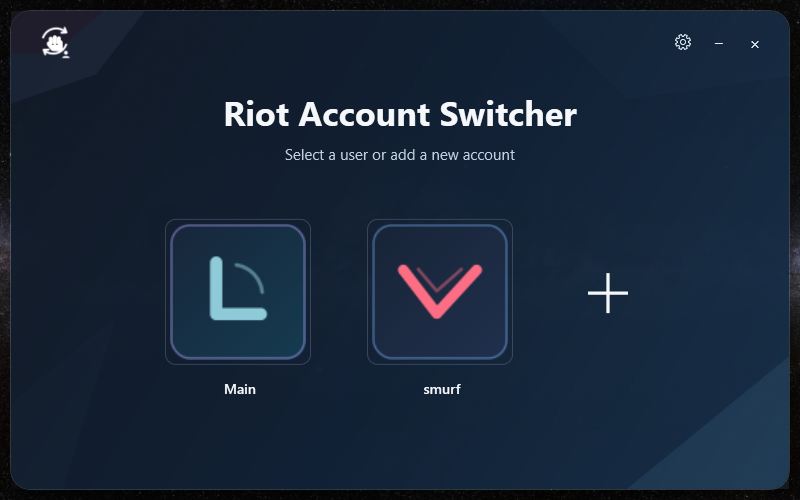
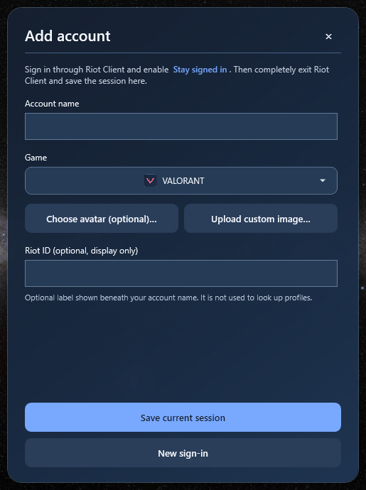
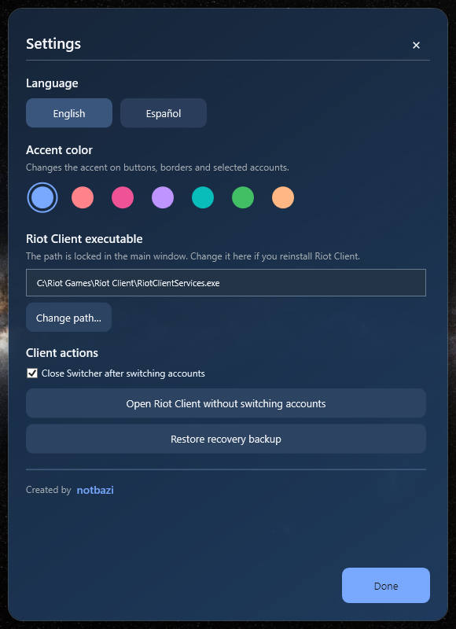
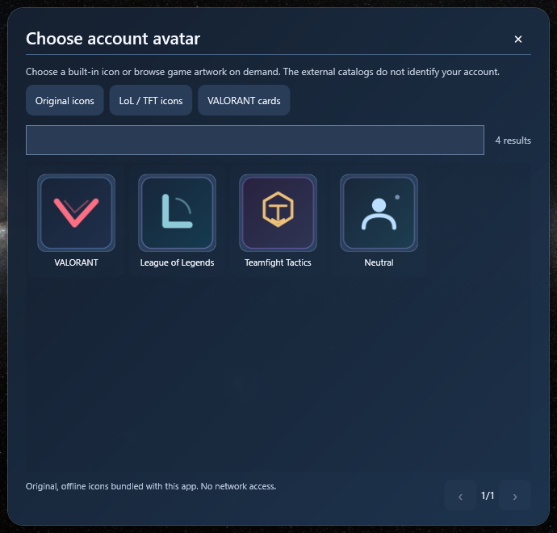

# Riot Account Switcher

[Read in English](../README.md)

Selector de cuentas **no oficial** para Riot Client en Windows, creado por **notbazi** con C#, WPF y .NET 10.

> **Beta pública no oficial (úsala bajo tu responsabilidad).** Esta aplicación no está afiliada ni aprobada por Riot Games. Restaura archivos locales de sesión mediante un mecanismo no documentado que Riot no ha confirmado como permitido. Una actualización del cliente podría impedir su funcionamiento; el uso de software de terceros no autorizado puede implicar riesgos para las cuentas. Las imágenes externas pertenecen a sus titulares. Lee los [avisos legales](../THIRD_PARTY_NOTICES.md) y las [recomendaciones de seguridad](../SECURITY.md).

## Funciones

- Selector de cuentas inspirado en Steam, con apodos e identificadores opcionales.
- Guardado/restauración de sesiones locales cifradas usando Windows DPAPI.
- Español e inglés, colores de acento y estética Oxocarbon Glass.
- Iconos originales incluidos que funcionan sin conexión.
- Galería **opcional** de iconos de LoL/TFT mediante Data Dragon de Riot y de tarjetas de VALORANT mediante el catálogo comunitario Valorant-API.
- Importación de PNG/JPEG personalizados; ya **no se usa OP.GG ni se busca al jugador automáticamente**.

## Capturas de pantalla

| Agregar cuenta | Personalizar ajustes |
|:--:|:--:|
|  |  |

**Elegir avatar:** selecciona uno de los iconos originales incluidos o abre voluntariamente los catálogos externos de imágenes del juego.

*Las capturas muestran cuentas de ejemplo e iconos originales. Las ilustraciones disponibles en los catálogos externos no se incluyen en estas capturas ni en los paquetes del programa.*

## Uso

1. Pulsa **+**, asigna un nombre local y selecciona el juego.
2. Inicia sesión **en Riot Client oficial**, activa **Mantener sesión iniciada** y ciérralo completamente, incluida la bandeja del sistema.
3. Si quieres, escribe el Riot ID para mostrarlo bajo el nombre; **no se envía a ninguna web**.
4. Elige un avatar original o abre voluntariamente un catálogo externo y selecciona una imagen.
5. Pulsa **Guardar sesión actual**.
6. Desde el selector principal abre la cuenta guardada. Con clic derecho puedes renombrar, cambiar imagen o eliminar la entrada local.

La aplicación **no solicita contraseñas**, no omite el segundo factor y no puede garantizar que una sesión siga vigente. Riot Client podría cambiar el formato de sus archivos internos.

## Compilación

Instala el [SDK de .NET 10](https://dotnet.microsoft.com/download/dotnet/10.0) y ejecuta `COMPILAR-LIGERO.cmd` o `COMPILAR-PORTABLE.cmd`. Los ejecutables aparecerán en `dist/ligero` y `dist/portable` respectivamente. El portable incluye .NET y no requiere el runtime separado en otro computador.

## Privacidad

Todos tus perfiles y sesiones se guardan aparte, en `%LOCALAPPDATA%\RiotSwitcherAccount`. `profiles.json` contiene apodos e IDs opcionales en texto plano; los archivos `.session.bin` y `last-recovery.bin` están cifrados con DPAPI pero **siguen siendo confidenciales**. Nunca los compartas ni los subas a GitHub.

Los catálogos solo se consultan al pulsar su botón. No envían nombres de cuentas, Riot IDs ni claves. El catálogo LoL utiliza Data Dragon; el de VALORANT utiliza Valorant-API, **no oficial**. Las imágenes elegidas se almacenan localmente y no se empaquetan en el `.exe`.

El código y los iconos originales se ofrecen bajo [MIT](../LICENSE). La licencia no concede derechos sobre imágenes de los juegos ni constituye autorización de Riot para el mecanismo de cambio de sesiones. Revisa [avisos legales](../THIRD_PARTY_NOTICES.md), [seguridad](../SECURITY.md) y [comprobaciones para publicar](../PUBLISH_CHECKLIST.md).

**Estado de distribución:** es una beta experimental independiente, no una integración oficial. Publicarla no significa que Riot haya autorizado el mecanismo de cambio de cuentas o el uso de catálogos externos.
